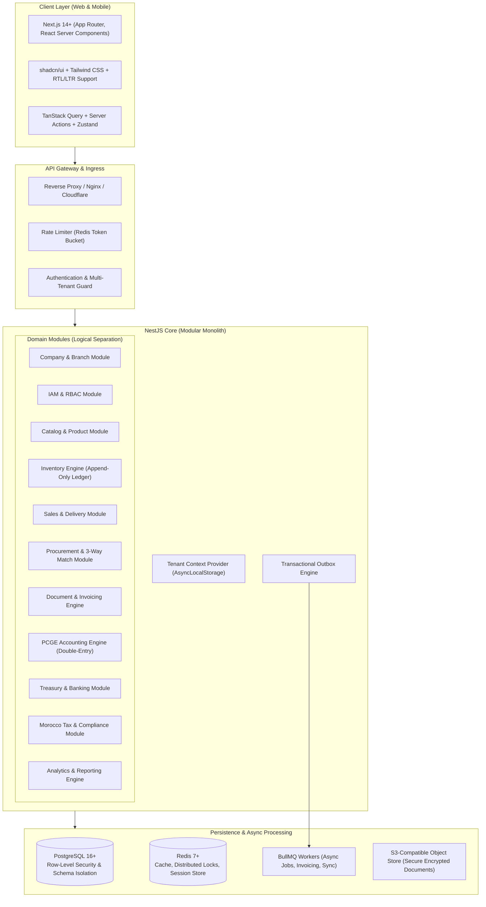

# MOROCCO BUSINESS OS — System Architecture Specification
**Document Version:** 1.0.0  
**Status:** Approved Architecture Baseline  
**Target Platform:** Cloud-Based Multi-Tenant ERP SaaS (Modular Monolith)

---

## 1. Architectural Strategy: Modular Monolith

To guarantee transactional consistency, auditability, data integrity, and strict tenant isolation without the latency, eventual consistency complexities, and DevOps overhead of microservices, **Morocco Business OS** is architected as a **Strict Modular Monolith**.

### 1.1 High-Level Architecture Diagram

---

## 2. Multi-Tenant Architecture & Data Isolation

Data isolation is non-negotiable. Every query, report, cache key, and background job must strictly operate within an authenticated tenant context.

### 2.1 Multi-Tenancy Strategy: Hybrid Pooled with Row-Level Security (RLS)
- **Primary Model:** Single database with strict tenant partitioning via `tenant_id` on all business entities.
- **Defense in Depth:**
  1. **Application Context:** NestJS interceptor extracts `tenant_id` from cryptographically signed JWT/Session and binds it to NodeJS `AsyncLocalStorage`.
  2. **ORM Layer (Prisma Extension):** All queries automatically inject `WHERE tenant_id = currentTenantId` at the query builder layer. Direct unfiltered queries are blocked at build/lint and runtime.
  3. **Database Level (PostgreSQL RLS):** For critical ledgers (Accounting, Inventory, Banking), PostgreSQL Row-Level Security policies are enforced using `SET LOCAL app.current_tenant_id = :tenantId`.
  4. **Document Storage:** Files stored in S3 are organized with strict key prefixes: `tenants/{tenant_id}/{module}/{year}/{filename}`. Pre-signed URLs are generated with short-lived TTLs (max 15 minutes) and signed against authorized session tokens.

### 2.2 Tenant Lifecycle & Provisioning
1. User registration creates a Tenant record with default Currency (`MAD`), base language (`ar` or `fr`), and default Moroccan Chart of Accounts (PCGE).
2. Primary Branch and Main Warehouse are auto-initialized inside an atomic database transaction.
3. Super Administrator role is assigned to the registering account with MFA enforcement capability.

---

## 3. Core Engine Architecture

### 3.1 Inventory Ledger Engine (Append-Only Ledger)
- **Zero In-Place Updates:** Quantity balances are never modified by direct `UPDATE` statements on balance tables.
- **Movement Records:** Every stock change generates an immutable `StockMovement` and `StockMovementLine`.
- **Materialized Stock Balances:** Fast reads are maintained via an aggregate balance table (`stock_balances`) updated strictly inside the same database transaction as the movement line.
- **Valuation Engines:**
  - **FIFO (First-In, First-Out):** Layered cost queues tracking remaining quantity per receipt lot.
  - **Weighted Average Cost (WAC / PUMP):** Recalculated dynamically upon every approved goods receipt:
    $$\text{New WAC} = \frac{(\text{Current Qty} \times \text{Current WAC}) + (\text{Received Qty} \times \text{Unit Cost})}{\text{Current Qty} + \text{Received Qty}}$$
- **Negative Stock Prohibition:** Real-time lock check prevents negative stock transactions unless an explicit company-level negative stock override is permitted by authorized policy.

### 3.2 Double-Entry Accounting Engine (PCGE Morocco)
- Strict double-entry accounting:
  $$\sum \text{Debits} = \sum \text{Credits}$$
- **Immutable Journal Entries:** Once an entry is marked `POSTED`, it cannot be edited or deleted. Corrections must strictly proceed via approved reversal entries (`REVERSED`).
- **Standard Moroccan Accounting Schema (PCGE):**
  - Class 1: Permanent Capital Accounts (Comptes de capitaux permanents)
  - Class 2: Fixed Asset Accounts (Comptes d'actif immobilisé)
  - Class 3: Current Asset Accounts (Comptes d'actif circulant)
  - Class 4: Current Liability Accounts (Comptes de passif circulant)
  - Class 5: Financial Accounts (Comptes de trésorerie)
  - Class 6: Expense Accounts (Comptes de charges)
  - Class 7: Income Accounts (Comptes de produits)
  - Class 8: Special Accounts (Comptes de résultats)

### 3.3 Document Engine & Three-Way Matching
- Automated document state machine:
  - Quotation $\rightarrow$ Sales Order $\rightarrow$ Delivery Note (BL) $\rightarrow$ Sales Invoice (Facture).
  - Purchase Request $\rightarrow$ Purchase Order $\rightarrow$ Goods Receipt (BR) $\rightarrow$ Supplier Invoice (Facture Fournisseur).
- **Three-Way Match Verification:** Automated discrepancy validation checking Unit Price, Quantity, and Tax across Purchase Order, Goods Receipt, and Supplier Invoice before payment approval.

---

## 4. Technology Stack & Technical Baseline

| Layer | Technology | Justification |
|---|---|---|
| **Frontend Framework** | Next.js 14+ (App Router, RSC) | SSR, streaming UI, exceptional bilingual (RTL/LTR) routing. |
| **Language** | TypeScript 5.x (Strict Mode) | End-to-end type safety, strict null checking, zero `any` policy. |
| **UI Components** | Tailwind CSS + shadcn/ui | Accessible, highly customizable, native RTL support for Arabic. |
| **State & Data Fetching** | TanStack React Query v5 | Cache invalidation, optimistic updates, request deduplication. |
| **Backend Framework** | NestJS 10+ | Strict modular architecture, dependency injection, enterprise testing. |
| **Database & ORM** | PostgreSQL 16 + Prisma | ACID compliance, JSONB support, powerful constraints and indexing. |
| **Cache & Distributed Locks** | Redis 7+ | High-speed caching, distributed idempotency locks, rate limiting. |
| **Background Jobs** | BullMQ | Reliable asynchronous message processing, scheduled crons, retries. |
| **API Specification** | OpenAPI 3.0 / Swagger | Auto-generated API documentation and client SDK generation. |
| **Testing Harness** | Vitest + Playwright | Unit/Integration testing (Vitest) and End-to-End browser tests (Playwright). |
| **Observability** | OpenTelemetry + Sentry | Distributed tracing, structured JSON logging, error tracking. |

---

## 5. Security & Boundary Architecture

1. **Authentication:** Argon2id password hashing, Stateless JWT with sliding session tokens in Redis for revocation capability.
2. **Authorization:** Granular RBAC supporting resource, branch, and warehouse scoping (`PermissionGuard`).
3. **Idempotency Keys:** Every mutative financial and inventory operation requires an `Idempotency-Key` HTTP header cached in Redis for 24 hours to prevent duplicate submissions.
4. **Data Protection & Legal Compliance:**
   - Full compliance with Moroccan Law 09-08 (CNDP guidelines for personal data protection).
   - Sensitive legal IDs (ICE, IF, RC, TP) and bank account numbers are audited on modification and masked in logs.
