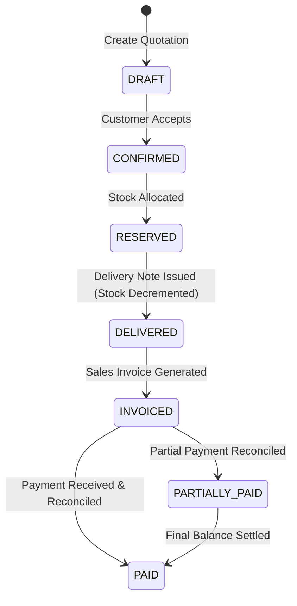

# MOROCCO BUSINESS OS — Business Rules Specification
**Document Version:** 1.0.0  
**Status:** Invariable Business Rules

---

## 1. The 10 Invariable Core Principles

Every pull request, migration, API endpoint, and test suite must comply with these ten foundational tenets:

1. **Complete Tenant Isolation:** Data from different companies can never intermingle. Unscoped queries are strictly blocked.
2. **Immutable Audit Trail:** Operation history cannot be erased. Every system event stores actor ID, timestamp, and previous state.
3. **No Deletion of Approved Records:** Confirmed stock movements, approved invoices, posted journal entries, and bank transactions can never be deleted from the database.
4. **No Direct Stock Balance Modification:** Stock balances are computed from an append-only ledger of movements. Direct `UPDATE` queries on stock quantities are prohibited.
5. **Strictly Balanced Double-Entry Accounting:** No journal entry may be posted unless:
   $$\sum \text{Debit} = \sum \text{Credit}$$
6. **No Duplicate Invoicing / Approval:** An invoice or document number cannot be used twice within the same company and fiscal year sequence.
7. **Explicit Role-Based & Financial Limit Authorizations:** High-value purchases, write-offs, credit limit breaches, and fiscal period closures require explicit role approvals and audit logs.
8. **Data Accuracy Over UI Velocity:** Under no circumstances should backend consistency checks be skipped or deferred to make UI buttons appear faster.
9. **Total Auditability:** Every financial movement is linked to its originating source document.
10. **Single Master Data Source:** Inventory, sales, purchasing, and accounting share standard master entities (Products, Partners, Accounts).

---

## 2. Inventory Engine Rules

### 2.1 Balance Formula
$$\text{Ending Balance} = \text{Opening Balance} + \sum \text{Receipts} - \sum \text{Issues}$$
$$\text{Available Stock} = \text{On-Hand Stock} - \text{Reserved Stock}$$

### 2.2 Reversal & Correction Policy
- A stock movement in status `COMPLETED` can never be edited or destroyed.
- Corrections must be processed via an inverse movement with:
  - `movement_type`: Original type with `_RETURN` or `INVENTORY_ADJUSTMENT`.
  - `reversed_movement_id`: UUID pointing to the original movement.
  - Reason code and mandatory user note.

### 2.3 Valuation Recalculation (WAC / PUMP)
When goods receipt is posted:
$$\text{WAC}_{\text{new}} = \frac{(Q_{\text{current}} \times C_{\text{current}}) + (Q_{\text{received}} \times C_{\text{received}})}{Q_{\text{current}} + Q_{\text{received}}}$$
- If $Q_{\text{current}} + Q_{\text{received}} \le 0$, the last valid WAC is retained.
- Historical unit costs on previous movements remain frozen and are never updated retrospectively.

---

## 3. Commercial & Procurement Rules

### 3.1 Three-Way Matching (Procurement)
Before a Supplier Invoice is approved for payment, the system validates the 3-Way Match:
1. **Purchase Order (PO)** $\leftrightarrow$ **Goods Receipt (GR)** $\leftrightarrow$ **Supplier Invoice (SI)**
2. Tolerances:
   - Quantity discrepancy: $0\%$ (Strict). Invoicing cannot exceed received quantity without managerial approval.
   - Price discrepancy: Max $\pm 0.5\%$ or $10\text{ MAD}$ without re-approval workflow.
   - Tax rate discrepancy: $0\%$ (Strict match with applicable Moroccan tax regime).

### 3.2 Sales State Machine

---

## 4. Moroccan Accounting (PCGE) & Tax Compliance

### 4.1 Standard Journal Mappings
1. **Sales Invoice Approval:**
   - **Debit:** Account `3421` (Clients) $\rightarrow \text{Total TTC}$
   - **Credit:** Account `7111` (Ventes de marchandises) $\rightarrow \text{Total HT}$
   - **Credit:** Account `4455` (État, TVA facturée) $\rightarrow \text{TVA Amount}$

2. **Supplier Invoice Approval:**
   - **Debit:** Account `6111` (Achats de marchandises) $\rightarrow \text{Total HT}$
   - **Debit:** Account `3455` (État, TVA récupérable sur charges) $\rightarrow \text{TVA Amount}$
   - **Credit:** Account `4411` (Fournisseurs) $\rightarrow \text{Total TTC}$

3. **Customer Payment Receipt (Bank Transfer):**
   - **Debit:** Account `5141` (Banques) $\rightarrow \text{Amount Paid}$
   - **Credit:** Account `3421` (Clients) $\rightarrow \text{Amount Paid}$

### 4.2 Moroccan Tax Compliance Rules (CGI)
- **TVA Rates:**
  - `20%`: Standard rate (applied by default to manufactured goods and services).
  - `14%`: Building work, transport, electrical energy.
  - `10%`: Tourism, catering, petroleum products, banking transactions.
  - `7%`: Pharmaceutical products, water, sugar, school supplies.
  - `0%`: Exemptions with deduction right (Exports, Article 92 CGI).
- **Mandatory Invoice Mentions:**
  - Seller & Buyer ICE (15 digits)
  - Identifiant Fiscal (IF)
  - Registre de Commerce (RC) and Court city
  - Taxe Professionnelle (TP)
  - Chronological uninterrupted sequence number per branch and year
  - Breakdown of TVA bases and rates.
