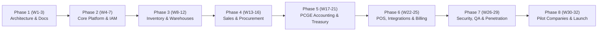

# MOROCCO BUSINESS OS — Development Backlog & 32-Week Execution Roadmap
**Document Version:** 1.0.0  
**Methodology:** Agile / Milestone-Driven (Definition of Done Enforced)  
**Total Timeline:** 32 Weeks (Phases 1 to 8)

---

## Roadmap Overview

---

## Phase Breakdown & Milestone Tasks

### Phase 1: Architecture, Monorepo Setup & Data Baseline (Weeks 1–3) [COMPLETED]
- [x] Baseline PRD approved and stored at [PRD.md](file:///Users/khalidaitelmaati/Desktop/stock/docs/PRD.md).
- [x] Architecture Specification approved at [ARCHITECTURE.md](file:///Users/khalidaitelmaati/Desktop/stock/docs/ARCHITECTURE.md).
- [x] PostgreSQL & Prisma Data Schema specified at [DATABASE.md](file:///Users/khalidaitelmaati/Desktop/stock/docs/DATABASE.md).
- [x] Invariable Business Rules established at [BUSINESS_RULES.md](file:///Users/khalidaitelmaati/Desktop/stock/docs/BUSINESS_RULES.md).
- [x] REST API and Swagger contract defined at [API.md](file:///Users/khalidaitelmaati/Desktop/stock/docs/API.md).
- [x] UI/UX & Bilingual Design System specified at [UI_UX_SPEC.md](file:///Users/khalidaitelmaati/Desktop/stock/docs/UI_UX_SPEC.md).
- [x] Threat Model and Security Strategy defined at [SECURITY.md](file:///Users/khalidaitelmaati/Desktop/stock/docs/SECURITY.md).
- [x] Acceptance Test Matrix defined at [TESTING.md](file:///Users/khalidaitelmaati/Desktop/stock/docs/TESTING.md).

---

### Phase 2: Core Platform, Multi-Tenancy & IAM (Weeks 4–7)
- **Task 2.1:** Turborepo monorepo scaffolding (`apps/web`, `apps/api`, `packages/shared`, `packages/ui`).
- **Task 2.2:** Multi-tenant PostgreSQL database migration setup with Prisma.
- **Task 2.3:** Tenant Context middleware and `AsyncLocalStorage` implementation.
- **Task 2.4:** Authentication engine (Argon2id, JWT, Refresh Tokens, Redis session tracker).
- **Task 2.5:** RBAC permission guards with branch and warehouse level scoping.
- **Task 2.6:** Company legal profiles setup (ICE, IF, RC, TP, CNSS).

---

### Phase 3: Inventory Engine & Warehouses (Weeks 8–12)
- **Task 3.1:** Product catalog (Stockable, Consumable, Services, Barcode index).
- **Task 3.2:** Append-Only stock movement ledger implementation (`stock_movements`, `stock_movement_lines`).
- **Task 3.3:** Real-time stock balance recalculation engine with distributed locks.
- **Task 3.4:** WAC (PUMP) and FIFO cost calculation logic.
- **Task 3.5:** Multi-warehouse internal transfers and transit status flow.
- **Task 3.6:** Reversal movement mechanism (Counter-movements).

---

### Phase 4: Commercial Operations (Sales & Procurement) (Weeks 13–16)
- **Task 4.1:** Customer & Supplier directories with Moroccan legal identity validations.
- **Task 4.2:** Sales lifecycle: Quotation $\rightarrow$ Sales Order $\rightarrow$ Stock Reservation $\rightarrow$ Delivery Note (BL).
- **Task 4.3:** Procurement lifecycle: Purchase Request $\rightarrow$ Purchase Order $\rightarrow$ Goods Receipt (BR).
- **Task 4.4:** Three-Way Matching engine (PO vs GR vs Supplier Invoice).
- **Task 4.5:** Moroccan legal invoice generator with bilingual PDF streaming (Arabic / French).

---

### Phase 5: Accounting (PCGE) & Treasury Engine (Weeks 17–21)
- **Task 5.1:** Pre-seeded Moroccan Chart of Accounts (Classes 1 through 8 PCGE).
- **Task 5.2:** Balanced Double-Entry Journal Entry posting engine with database transaction locks.
- **Task 5.3:** Automatic journal generation from Sales Invoices, Purchase Invoices, and Payments.
- **Task 5.4:** Cash & Bank Treasury accounts, check tracking, and bank reconciliation.
- **Task 5.5:** General Ledger (Grand Livre) and Trial Balance (Balance Générale) generator.
- **Task 5.6:** Fiscal period closure and period lock guards.

---

### Phase 6: Point of Sale (POS) & SaaS Billing (Weeks 22–25)
- **Task 6.1:** High-velocity POS interface with barcode scanner support and quick cash settlement.
- **Task 6.2:** Offline local-storage transaction queue with sync conflict resolver.
- **Task 6.3:** Subscription management engine (Stripe / Moroccan CMI payment gateways).
- **Task 6.4:** Plan quota limiter middleware (User limits, Branch limits, Storage limits).

---

### Phase 7: Security Audit, QA & Penetration Testing (Weeks 26–29)
- **Task 7.1:** Automated cross-tenant isolation attack test suite.
- **Task 7.2:** Financial balance verification stress tests and race condition simulation.
- **Task 7.3:** Moroccan tax declaration audit report testing (TVA deductions & declarations).
- **Task 7.4:** Performance benchmarking (P95 < 500ms on all core transactional routes).

---

### Phase 8: Pilot Deployment & Commercial Launch (Weeks 30–32)
- **Task 8.1:** Closed beta rollout to Moroccan SME pilot companies.
- **Task 8.2:** Data migration tooling for legacy Excel / Sage / Ciel exports.
- **Task 8.3:** Final production hardening, disaster recovery drills, and SLA verification.
