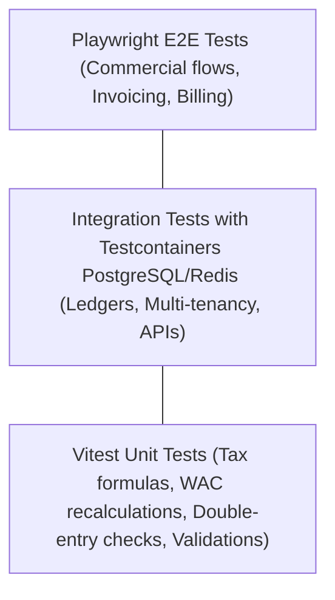

# MOROCCO BUSINESS OS — Testing & Verification Strategy
**Document Version:** 1.0.0  
**Test Frameworks:** Vitest (Unit & Integration), Playwright (End-to-End)  
**Coverage Mandate:** > 90% on Financial & Inventory Calculation Engines

---

## 1. Automated Testing Pyramid

---

## 2. Core Acceptance Test Suites

### 2.1 Inventory Ledger Verification Scenarios

#### Scenario 1: Comprehensive Movement Flow
- **Step 1:** Post Opening Balance: $100$ units in Warehouse A.
- **Step 2:** Receive Purchase: $50$ units in Warehouse A.
- **Step 3:** Issue Sales: $20$ units from Warehouse A.
- **Step 4:** Internal Transfer: $30$ units from Warehouse A to Warehouse B.
- **Expected Outcome:**
  - Warehouse A: $100 + 50 - 20 - 30 = 100$ units.
  - Warehouse B: $30$ units.
  - Total Enterprise Stock: $130$ units.

#### Scenario 2: Idempotency & Duplicate Request Protection
- **Step 1:** Submit `POST /api/v1/purchases/receipts` with `Idempotency-Key: test-uuid-001`.
- **Step 2:** Re-send the exact request with identical `Idempotency-Key`.
- **Expected Outcome:**
  - Status 200/201 on both requests.
  - Stock movement ledger contains exactly ONE movement line.
  - Stock balance is incremented only once.

#### Scenario 3: Movement Reversal & Immutability Check
- **Step 1:** Complete a Stock Movement of $50$ units.
- **Step 2:** Attempt direct `DELETE FROM stock_movements WHERE id = ...`.
  - **Result:** Database trigger raises exception. Deletion fails.
- **Step 3:** Execute `POST /api/v1/inventory/movements/:id/reverse`.
  - **Result:** Original movement marked `REVERSED`. Counter-movement of $-50$ units created. Stock balance restored.

---

### 2.2 Accounting Engine Verification Scenarios

1. **Unbalanced Journal Entry Rejection:**
   - Attempt posting entry with Debit: $10,000\text{ MAD}$ and Credit: $9,500\text{ MAD}$.
   - **Expected Result:** HTTP 422 Unprocessable Entity. No database rows created.
2. **Lock on Closed Fiscal Periods:**
   - Attempt posting entry dated in a closed fiscal period.
   - **Expected Result:** Blocked by `PeriodLockGuard` with audit entry logged.
3. **PCGE Automatic Posting Match:**
   - Post a Sales Invoice with HT: $10,000\text{ MAD}$, TVA 20%: $2,000\text{ MAD}$, TTC: $12,000\text{ MAD}$.
   - **Expected Result:**
     - Account `3421` debited $12,000\text{ MAD}$.
     - Account `7111` credited $10,000\text{ MAD}$.
     - Account `4455` credited $2,000\text{ MAD}$.
     - Total Debits = Total Credits = $12,000\text{ MAD}$.

---

### 2.3 Strict Multi-Tenancy Isolation Verification

Automated test runner executes 5 hostile penetration tests between Tenant A and Tenant B:
1. Tenant A attempts to fetch Tenant B's invoice by ID: **Must return 404 Not Found**.
2. Tenant A attempts to update Tenant B's product stock: **Must return 404 / 403**.
3. Tenant A attempts to access Tenant B's S3 storage pre-signed URL: **Must return 403 Forbidden**.
4. Background worker receives job without `tenant_id`: **Job immediately rejected and moved to dead-letter queue**.
5. SQL Injection test attempting to bypass `tenant_id` filter: **Blocked and sanitized by Prisma/PostgreSQL parameters**.
