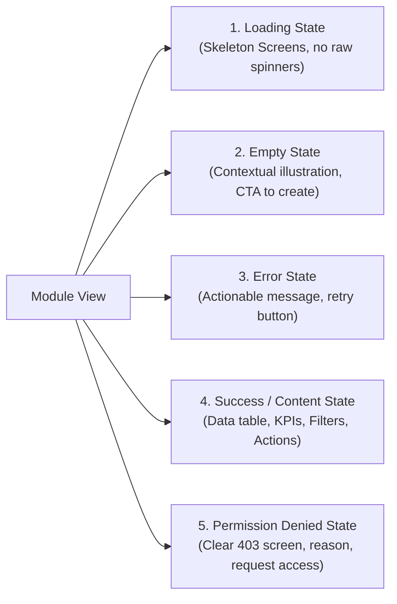

# MOROCCO BUSINESS OS — UI/UX & Design Specification
**Document Version:** 1.0.0  
**Design System:** Tailwind CSS + shadcn/ui + Radix UI Primitives  
**Language Support:** Arabic (RTL, Primary) & French (LTR, Primary)  
**Viewport Target:** Desktop-First Responsive (Breakpoints: 1280px, 1024px, 768px, 375px)

---

## 1. Typography & Localization Strategy

1. **Bilingual Typeface Pairing:**
   - **Arabic (RTL):** `IBM Plex Sans Arabic` or `Cairo` (Weights: 400 Regular, 500 Medium, 600 SemiBold, 700 Bold).
   - **French / Latin (LTR):** `Inter` or `Geist Sans`.
   - **Monetary / Numerics:** Fixed-width tabular figures (`font-variant-numeric: tabular-nums;`) for clean column alignment across currencies and balances.
2. **Dynamic Direction (`dir` Attribute):**
   - Root document dynamically toggles `dir="rtl"` when Arabic is selected, and `dir="ltr"` when French is selected.
   - All flex, grid, margin, and padding classes utilize logical CSS properties (e.g., `ms-*`, `me-*`, `ps-*`, `pe-*`, `start-*`, `end-*`) to prevent layout breakage.

---

## 2. Standard Screen Structure & Five Mandatory States

Every domain module view must provide standard, unified layouts and explicitly handle 5 states:

### 2.1 Standard Module Screen Blueprint
1. **Header Zone:**
   - Breadcrumb navigation (`المخزون > المنتجات > إضافة منتج جديد`).
   - Page Title and contextual status badge.
   - Action Bar (Primary CTAs, Export Excel, Print PDF, Action dropdown).
2. **Filter & Search Bar:**
   - Instant debounced search (Product name, SKU, Barcode, Customer ICE).
   - Quick faceted filters (Branch, Warehouse, Status, Date Range).
   - Saved Views / Custom filter presets.
3. **Data Grid (Table Component):**
   - Resizable columns, sticky headers, multi-select rows for bulk operations.
   - Pagination controls with customizable page sizes (25, 50, 100).
   - Inline row hover actions (View Details, Edit, Reverse, Audit History).

---

## 3. High-Priority Screen Specifications

### 3.1 Fast Point-of-Sale (POS) & Order Creation Interface
- **Split-Screen UX:**
  - Left panel: Search / Barcode scanner stream / Category quick-tap grid.
  - Right panel: Live cart summary, discount controller, TVA breakdown, and instant payment settlement buttons (Espèces, Carte, Virement).
- **Offline Indicator:** Prominent visual badge indicating connectivity status with queue counter for pending synched operations.

### 3.2 Document Viewer & Printable Invoice (Facture Marocaine)
- A4 aspect ratio preview compliant with standard Moroccan fiscal requirements.
- Header block displaying Company Logo, ICE, IF, RC, TP, and CNSS.
- Customer block with validated ICE.
- Table containing items, quantities, UOM, Unit Price HT, TVA Rate, Total HT, Total TVA, and Total TTC.
- Legal footer with mandatory bank details (RIB) and legal mentions.
